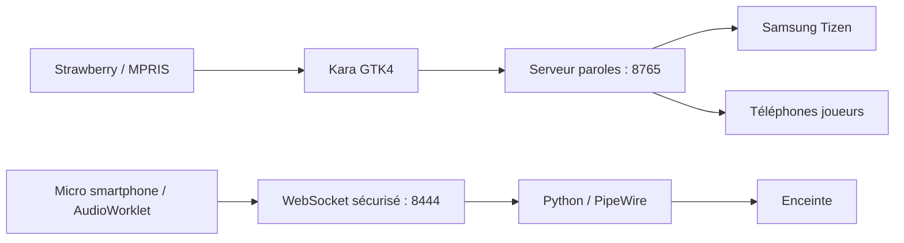

<h1 align="center">Kara Samsung</h1>

<p align="center">Karaoké multijoueur pour Arch Linux et Samsung Tizen : paroles LRC originales, Strawberry et microphones mobiles.</p>

<p align="center">
  
  
  
  
  
</p>

<p align="center">
  <a href="#-overview">Overview</a> · <a href="#-stack">Stack</a> · <a href="#-architecture">Architecture</a> ·
  <a href="#-repository">Repository</a> · <a href="#-quick-start">Quick Start</a> ·
  <a href="#-mirrors">Mirrors</a> · <a href="#-version">Version</a> · <a href="#-license">License</a>
</p>

## ✦ Overview

**Kara Samsung** est un karaoké multijoueur sur Arch Linux et la télévision Samsung. Les joueurs rejoignent le salon depuis leur téléphone. Strawberry joue le morceau original, la télévision suit le LRC et PipeWire restitue le micro sur l’enceinte. Parole conserve la bibliothèque, les imports, les recherches de paroles et la synchronisation USB.

## ✦ Stack

| Poste Linux | TV et mobile |
| --- | --- |
| Arch Linux · Sway · Strawberry · MPRIS | Samsung Tizen · JavaScript · HTML/CSS |
| Python · GTK4 / PyGObject · aiohttp | Application Web TV · interface joueurs |
| PipeWire · NumPy · SciPy | HTTPS/WebSocket · AudioWorklet · PCM 20 ms |



## ✦ Architecture

Le service utilisateur Kara sert la télévision et la page mobile en HTTPS. Il reçoit le PCM du téléphone sur un WebSocket distinct. Le joueur teste et confirme le retour sur l’enceinte avant le tour. Le volume musical et le volume du microphone se règlent séparément. BlackBox permet d’observer les niveaux, le transport et la sortie. Les outils historiques de notation et de minutage IA sont archivés sur la branche locale `archive/kara-avant-back-to-basics-20261127`.

## ✦ Repository

```text
kara-Samsung/
├── bin/             Application GTK4, serveurs et utilitaires
├── tizen/app/       Sources Samsung Tizen
├── native/src/      Code C DTW
├── tests/           Vérifications existantes
├── .runtime/        SDK, environnements, modèles et secrets (ignorés)
├── .gitignore
├── LICENSE
└── README.md
```

Le dossier historique `~/.local/share/kara` et les anciens lanceurs `~/.local/bin` restent compatibles grâce à des liens symboliques. `.runtime/` n'est pas suivi par Git.

## ✦ Quick Start

Sur une installation **déjà configurée comme ArchASP** :

```bash
cd ~/Documents/Development/kara-Samsung
python3 -m compileall -q bin
node --check bin/_kara_micro_worklet.js
node --check tizen/app/app.js

# Serveur micro de développement : nécessite le certificat local HTTPS
python3 -u bin/_kara_micro_test.py
```

Autres points d'entrée existants : `~/.local/bin/paroles-strawberry` (interface GTK4), `~/.local/bin/kara` (bibliothèque), `~/.local/bin/kara-tizen-tv` (émulateur Podman) et `~/.local/bin/kara-tv-test` (test TV).

**Prérequis à installer séparément :** Strawberry, GTK4/PyGObject, Python, aiohttp, NumPy/SciPy, PipeWire et les outils Tizen/Podman pour l'émulation. Il n'existe pas encore de script d'installation reproductible depuis zéro.

## ✦ Documentation

Le [guide Kara](docs/kara-v2.md) décrit l’attente musicale, le jeu et l’essai microphone.

| Ressource | Contenu |
| --- | --- |
| [Calibration audio](docs/audio-calibration.md) | Contrats, algorithmes, limites de mesure, tests et protocole S21FE à réaliser |
| [Qualification historique du chant](docs/kara-qualification-chant.md) | Archives des essais de reconnaissance |
| [Source Tizen](tizen/app/README.md) | Application TV |
| [Kara V2](docs/kara-v2.md) | Parcours mobile, attente musicale, BlackBox et démarrage avec Sway |
| [Code micro](bin/_kara_micro_test.py) | Serveur HTTPS WebSocket |
| [Page micro](bin/_kara_micro_test.html) | Interface mobile et calibration |
| [AudioWorklet](bin/_kara_micro_worklet.js) | Capture audio et paquets PCM |
| [Moteur de calibration](bin/_kara_audio_calibration.js) | DSP local et synthèse des essais |
| [Sondes de calibration](bin/_kara_audio_calibration.py) | Références déterministes et émission PipeWire bornée |
| [Source C](native/src/_kara_dtw.c) | Alignement natif DTW |

## ✦ Mirrors

| Rôle | Dépôt |
| --- | --- |
| Principal | [Forgejo](https://git.labfytools.com/fy59/kara-Samsung) |
| Miroir public | [GitHub](https://github.com/labfytools/kara-Samsung) |

Forgejo est le dépôt principal (`origin`), avec GitHub comme miroir. Les deux URLs de push peuvent publier le même historique ; il faut vérifier chaque destination lors d'un push.

## ✦ Version

| Branche | Usage |
| --- | --- |
| `main` | Développement du prototype |
| `feat/audio-calibration-engine` | Calibration expérimentale, validation synthétique et protocole physique à réaliser |

Aucune version stable n'est annoncée. Les essais de mesure audio ne valent pas certification de latence ni de compatibilité matérielle.

## ✦ Security

Les clés du serveur HTTPS sont dans `~/.local/state/kara/micro-test/` et **ne sont pas versionnées**. Sont aussi exclus : certificats de signature Tizen, SDK, `.runtime/`, musiques, données personnelles et enregistrements de voix. Vérifier toute publication avant le push.

## ✦ License

Distribué sous [licence MIT](LICENSE). Copyright (c) 2026 labfytools. Les dépendances tierces conservent leurs propres licences.
