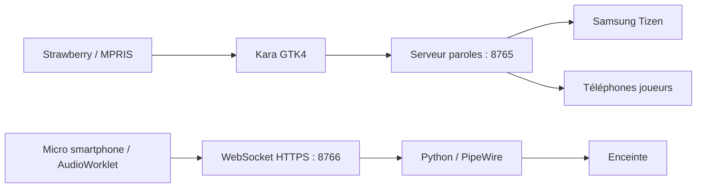

<h1 align="center">Kara Samsung</h1>

<p align="center">Karaoké multijoueur pour Arch Linux et Samsung Tizen : paroles synchronisées, Strawberry, microphones mobiles et analyse vocale.</p>

<p align="center">
  
  
  
  
  
</p>

<p align="center">
  <a href="#-overview">Overview</a> · <a href="#-stack">Stack</a> · <a href="#-architecture">Architecture</a> ·
  <a href="#-repository">Repository</a> · <a href="#-quick-start">Quick Start</a> ·
  <a href="#-mirrors">Mirrors</a> · <a href="#-version">Version</a> · <a href="#-license">License</a>
</p>

## ✦ Overview

**Kara Samsung** associe Strawberry (MPRIS), un poste Linux sous Sway, une interface TV Samsung Tizen et des téléphones pour une expérience de karaoké multijoueur. Le prototype intègre les paroles synchronisées, la préparation de parties et l'analyse expérimentale de voix chantée.

Le retour micro sans fil par navigateur, AudioWorklet, WebSocket et PipeWire est **expérimental** ; la latence acoustique et la régularité réseau sont encore à valider. Ce dépôt n'est pas une application prête à installer sur toutes les TV Samsung.

## ✦ Stack

| Poste Linux | TV et mobile |
| --- | --- |
| Arch Linux · Sway · Strawberry · MPRIS | Samsung Tizen · JavaScript · HTML/CSS |
| Python · GTK4 / PyGObject · aiohttp | Application Web TV · interface joueurs |
| PipeWire · NumPy · SciPy | HTTPS/WebSocket · AudioWorklet · PCM 20 ms |
| C · algorithme DTW | Client smartphone utilisé comme micro |



## ✦ Architecture

Le service TV (port **8765**) et le prototype de micro (port **8766**) sont distincts. Le microphone navigateur transmet des blocs audio de 20 ms. Les compteurs d'arrivée, de pertes et les diagnostics d'horodatage sont destinés à identifier la latence ; ils ne prouvent pas à eux seuls le temps de restitution acoustique.

L'interface de calibration n'envoie jamais le micro en direct à l'enceinte, afin d'éviter les boucles d'écho. Les artefacts Tizen et les environnements présents sur ArchASP ne sont pas des dépendances portables incluses dans Git.

La [calibration audio expérimentale](docs/audio-calibration.md) lance en un clic un amorçage puis six chirps et six séquences PN alternés, sans compensation. Les tests synthétiques sont disponibles et le protocole physique S21FE, analogique puis EDENWOOD choisie manuellement, reste à réaliser.

## ✦ Repository

```text
kara-Samsung/
├── bin/             Application GTK4, serveurs et utilitaires
├── tizen/app/       Sources Samsung Tizen
├── native/src/      Code C DTW
├── tests/           Vérifications existantes
├── .runtime/        SDK, environnements, modèles et secrets (ignorés)
├── .gitignore
├── LICENSE
└── README.md
```

Le dossier historique `~/.local/share/kara` et les anciens lanceurs `~/.local/bin` restent compatibles grâce à des liens symboliques. `.runtime/` n'est pas suivi par Git.

## ✦ Quick Start

Sur une installation **déjà configurée comme ArchASP** :

```bash
cd ~/Documents/Development/kara-Samsung
python3 -m compileall -q bin
node --check bin/_kara_micro_worklet.js
node --check tizen/app/app.js

# Serveur micro de développement : nécessite le certificat local HTTPS
python3 -u bin/_kara_micro_test.py
```

Autres points d'entrée existants : `~/.local/bin/paroles-strawberry` (interface GTK4), `~/.local/bin/kara` (bibliothèque), `~/.local/bin/kara-tizen-tv` (émulateur Podman) et `~/.local/bin/kara-tv-test` (test TV).

**Prérequis à installer séparément :** Strawberry, GTK4/PyGObject, Python, aiohttp, NumPy/SciPy, PipeWire et les outils Tizen/Podman pour l'émulation. Il n'existe pas encore de script d'installation reproductible depuis zéro.

## ✦ Documentation

Le [guide Kara V1](docs/kara-v1.md) décrit la salle HTTPS, les commandes mobiles, le format BlackBox et le replay local.

| Ressource | Contenu |
| --- | --- |
| [Calibration audio](docs/audio-calibration.md) | Contrats, algorithmes, limites de mesure, tests et protocole S21FE à réaliser |
| [Qualification du chant](docs/kara-qualification-chant.md) | Banc PCM, score, résultats comparatifs et protocole ADB |
| [Source Tizen](tizen/app/README.md) | Application TV |
| [Code micro](bin/_kara_micro_test.py) | Serveur HTTPS WebSocket |
| [Page micro](bin/_kara_micro_test.html) | Interface mobile et calibration |
| [AudioWorklet](bin/_kara_micro_worklet.js) | Capture audio et paquets PCM |
| [Moteur de calibration](bin/_kara_audio_calibration.js) | DSP local et synthèse des essais |
| [Sondes de calibration](bin/_kara_audio_calibration.py) | Références déterministes et émission PipeWire bornée |
| [Source C](native/src/_kara_dtw.c) | Alignement natif DTW |

## ✦ Mirrors

| Rôle | Dépôt |
| --- | --- |
| Principal | [Forgejo](https://git.labfytools.com/fy59/kara-Samsung) |
| Miroir public | [GitHub](https://github.com/labfytools/kara-Samsung) |

Forgejo est le dépôt principal (`origin`), avec GitHub comme miroir. Les deux URLs de push peuvent publier le même historique ; il faut vérifier chaque destination lors d'un push.

## ✦ Version

| Branche | Usage |
| --- | --- |
| `main` | Développement du prototype |
| `feat/audio-calibration-engine` | Calibration expérimentale, validation synthétique et protocole physique à réaliser |

Aucune version stable n'est annoncée. Les essais de mesure audio ne valent pas certification de latence ni de compatibilité matérielle.

## ✦ Security

Les clés du serveur HTTPS sont dans `~/.local/state/kara/micro-test/` et **ne sont pas versionnées**. Sont aussi exclus : certificats de signature Tizen, SDK, `.runtime/`, musiques, données personnelles et enregistrements de voix. Vérifier toute publication avant le push.

## ✦ License

Distribué sous [licence MIT](LICENSE). Copyright (c) 2026 labfytools. Les dépendances tierces conservent leurs propres licences.
