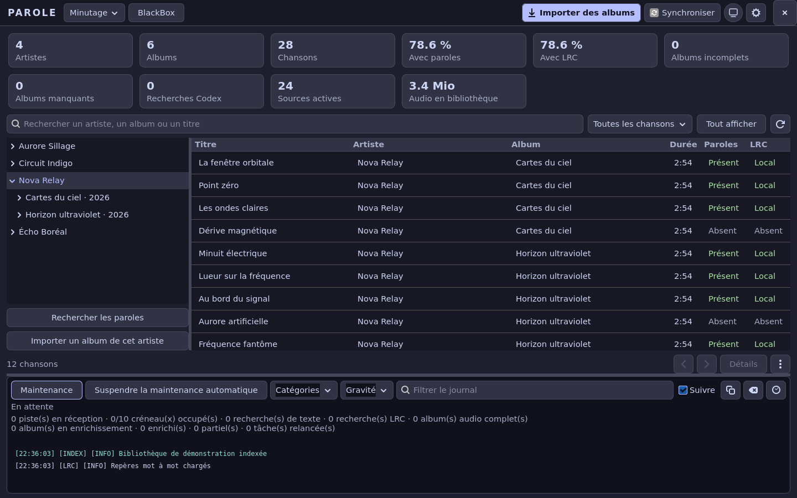

<h1 align="center">Kara sur Samsung · Parole sur le PC</h1>

<p align="center">
  Lance un morceau dans Strawberry. Kara affiche ses paroles sur la TV, jusqu’au mot quand le minutage d’origine le permet.<br>
  Parole organise ta bibliothèque, importe tes albums et retrouve leurs LRC.
</p>

<p align="center">
  <a href="#captures">Captures</a> ·
  <a href="#fonctionnement">Fonctionnement</a> ·
  <a href="#installation">Installation</a> ·
  <a href="#documentation">Documentation</a>
</p>

## Captures

### Kara · Affichage TV


*Rendu de l’application TV dans un navigateur de test, avec un morceau et des paroles de démonstration.*

### Parole · Bibliothèque Linux



*Capture de Parole sous GTK 4, avec une bibliothèque fictive.*

## Fonctionnement

| Tu veux… | Où agir |
| --- | --- |
| **Chanter sur un titre** | Lance le morceau dans **Strawberry** et ouvre **Kara** sur la Samsung. L’affichage suit la position de lecture, les pauses et les déplacements. |
| **Régler le son** | Règle la musique dans **Strawberry** et le niveau du microphone sur **l’enceinte**. |
| **Trouver les paroles du morceau en cours** | Ouvre **Minutage** dans Parole pour rechercher son LRC ou ajuster le décalage d’affichage. |
| **Importer un album** | Ouvre **Importer des albums** ou utilise **Ctrl+I**. Parole peut rechercher les paroles d’une piste dès qu’elle est téléchargée, vérifiée et rangée. |
| **Enrichir la bibliothèque la nuit** | Active **Paramètres → LRC nocturnes**. Sur secteur et session verrouillée, Parole recherche les LRC d’origine manquants, suit les quotas et garde la progression après redémarrage. |
| **Emporter la bibliothèque** | Utilise **Synchroniser** pour prévisualiser les copies et les conflits avant la synchronisation USB. |

### Le mot à mot, à partir des repères d’origine

Kara surligne les mots déjà minutés dans le LRC. Selon les données disponibles, il suit les lignes, affiche les paroles simples ou présente la pochette. Le réglage de décalage s’applique à l’affichage.

Parole privilégie les LRC mot à mot compatibles pendant la recherche multisource. La bibliothèque existante peut aussi être revérifiée pendant la maintenance de jour.

```sh
# Voir le détail de la bibliothèque indexée
./bin/paroles-musique --reverifier-mot-a-mot --apercu

# Inscrire les LRC ligne par ligne dans la file persistante
./bin/paroles-musique --reverifier-mot-a-mot
```

Kara peut utiliser une variante mot à mot validée pour la piste. Parole conserve son fichier LRC d’origine à côté de l’audio.

## Installation

### PC · Arch Linux

Parole utilise **Python**, **GTK 4**, **PyGObject** et **Strawberry** via MPRIS. Les imports audio utilisent notamment **FFmpeg** et **yt-dlp**, selon la source sélectionnée. Le [guide des imports](docs/parole-imports.md#dépendances-et-lancement) détaille les dépendances par parcours.

Depuis le dépôt local, crée le raccourci et ouvre la bibliothèque.

```sh
./bin/installer-parole
./bin/paroles-strawberry
```

Pour garder le serveur d’affichage disponible en arrière-plan, utilise l’[unité systemd utilisateur `kara.service`](contrib/systemd/user/kara.service). Elle lance Parole avec `--service` depuis `~/.local/bin/paroles-strawberry` et attend un écouteur HTTPS opérationnel.

### TV · Samsung Tizen

Prépare le widget dans un nouveau dossier privé avec `bin/kara-tv-package`. Le [guide Samsung](tizen/app/README.md) couvre la signature, l’installation via SDB et les vérifications de lecture. Le widget signé contient la clé d’affichage et se conserve dans l’espace utilisateur.

## Documentation

| Guide | Contenu |
| --- | --- |
| [Parole](docs/parole-v3.md) | Bibliothèque, maintenance, index et synchronisation USB |
| [Imports et téléchargements](docs/parole-imports.md) | Sources audio, file d’import, reprise et diagnostics |
| [Fournisseurs de paroles](docs/parole-sources-v3.md) | LRC d’origine, choix de l’édition, quotas et caches |
| [Mode capot fermé](docs/parole-capot-ferme.md) | Conditions et protections de la recherche nocturne |
| [Installation Samsung](tizen/app/README.md) | Construction, signature et installation de Kara |
| [BlackBox](blackbox/README.md) | Diagnostics locaux et lecture des anciennes captures |
| [Journal des changements](CHANGELOG.md) | Évolutions de Kara et Parole |

<details>
<summary>Archives et retour arrière</summary>

Les anciens parcours sont conservés dans les branches locales `archive/kara-avant-back-to-basics-20261127` et `archive/kara-multijoueur-2.1.0`. Les données privées et les captures restent dans l’espace utilisateur.

Pour revenir à une version précédente, restaure le raccourci, l’unité utilisateur et ses paramètres de lancement depuis la sauvegarde de déploiement, puis redémarre le service. Sur Samsung, réinstalle le paquet signé précédent. Le retour de version utilise la bibliothèque et les données présentes.

</details>

[Licence MIT](LICENSE)
